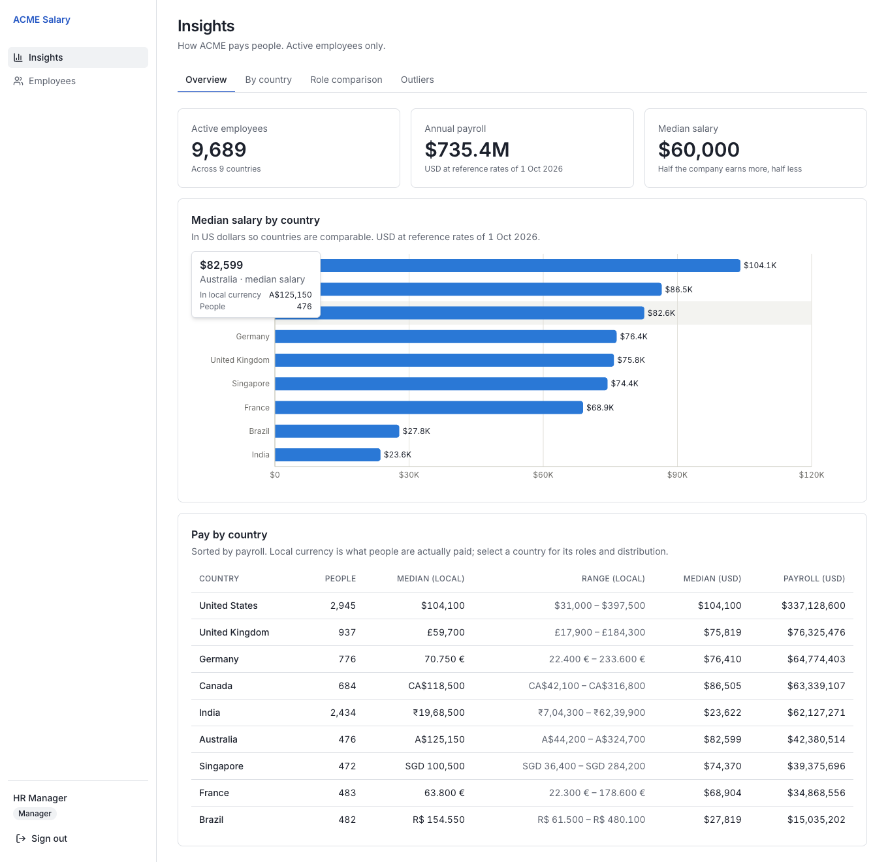
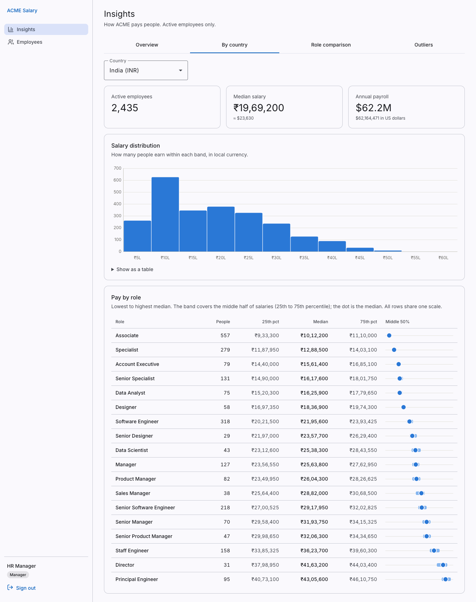
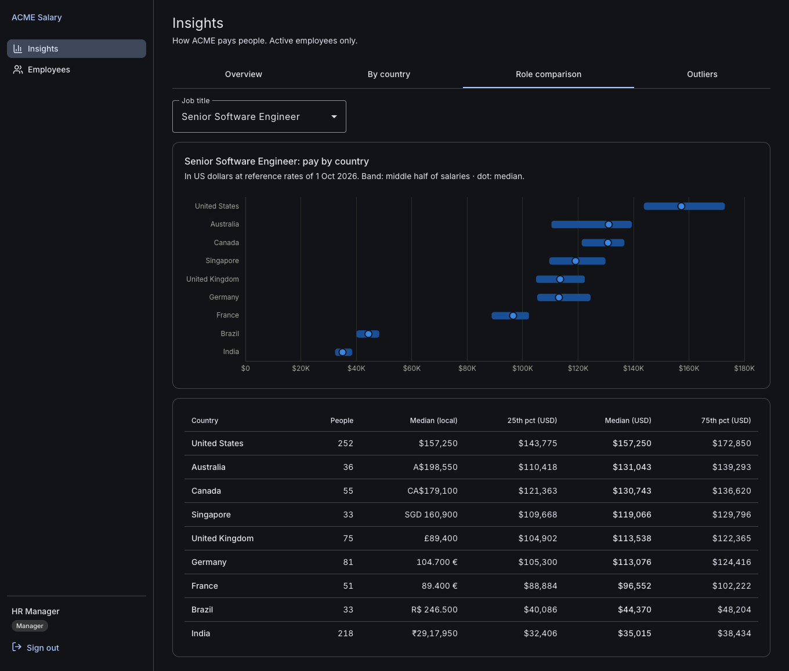
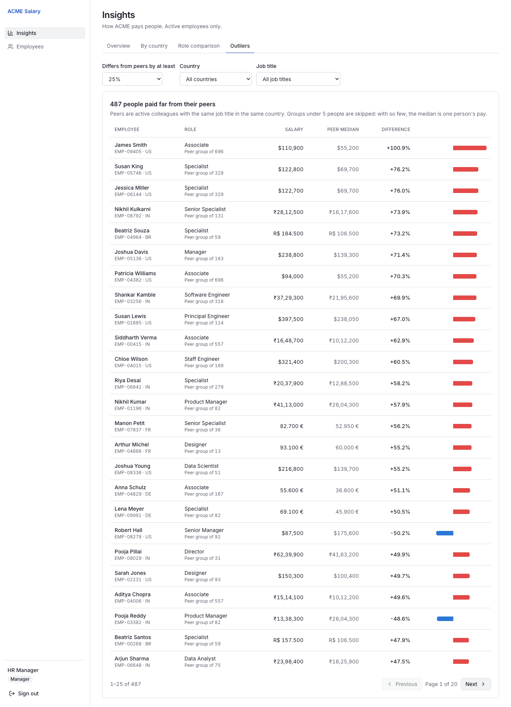
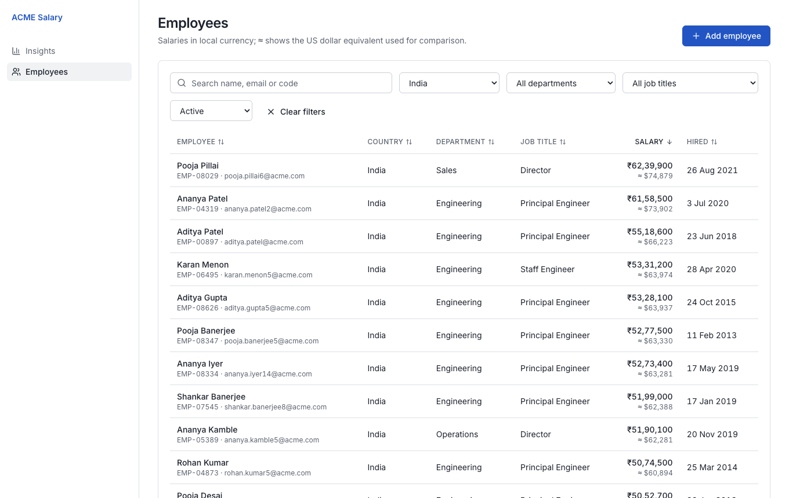
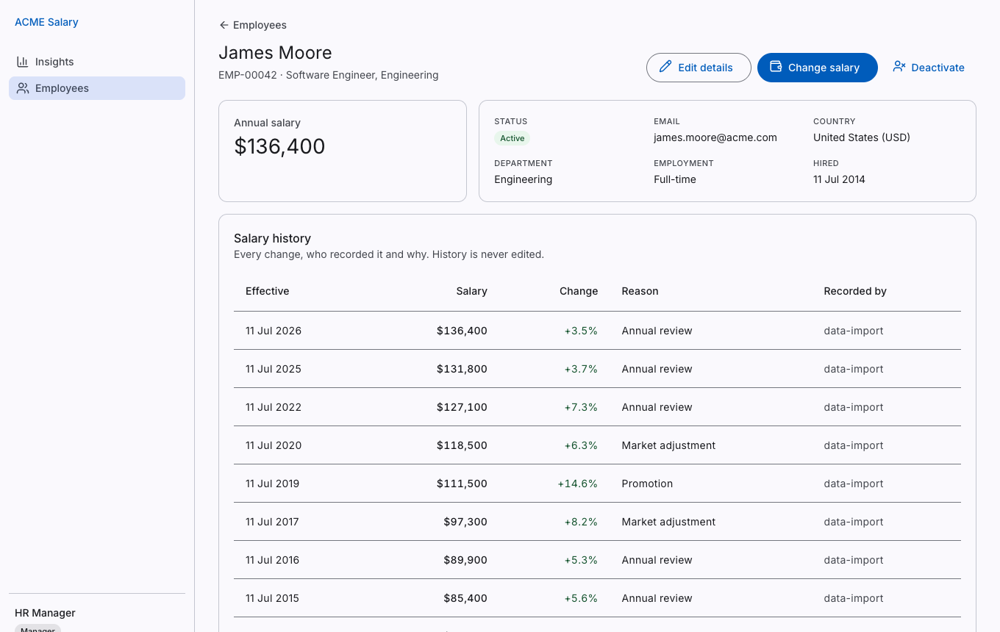

# ACME Salary Management

Web application for ACME's HR Manager to maintain salary data for 10,000 employees across nine
countries, and to answer how the organisation pays people — replacing a set of spreadsheets.

| Insights overview | Pay by country (India) |
|---|---|
|  |  |

| Role comparison (dark mode) | Outliers |
|---|---|
|  |  |

| Employee directory | Employee and salary history |
|---|---|
|  |  |

## Run it

The release runs anywhere Docker does. It is **not deployed to a public URL** by choice; this
one command starts the full stack (Postgres, API, UI) and seeds 10,000 employees:

```bash
cp .env.example .env        # set every password (at least 12 characters)
docker compose -f compose.release.yml up -d --build
open http://localhost:3000  # sign in with BOOTSTRAP_MANAGER_* (or *_ANALYST_*) from .env
```

Only the UI port is published; the API and database stay inside the compose network. Stop with
`docker compose -f compose.release.yml down` (add `-v` to delete the data).

<details>
<summary>Run from source instead (for development)</summary>

Prerequisites: Java 21+, Docker, Node 22, pnpm 12.

```bash
docker compose up -d postgres                                   # Postgres 16 on localhost:5433
cp .env.example .env && set -a && source .env && set +a
(cd backend && ./mvnw -q -pl salary-app -am spring-boot:run)    # API on :8080
(cd frontend && pnpm install && pnpm dev)                       # UI on http://localhost:3000
```

Tests: `cd backend && ./mvnw clean verify` (needs Docker for Testcontainers) and
`cd frontend && pnpm test`.
</details>

## What it does

| HR question | Where |
|---|---|
| What do we pay for a role in each country? | Insights → Role comparison (USD, middle 50% + median) |
| What does each role earn within a country? | Insights → By country → pay ladder |
| Where are most people's salaries? | Insights → By country → distribution |
| Who is paid far from their peers? | Insights → Outliers (same role and country) |
| How has someone's pay changed, and why? | Employee → salary history (who, when, why) |
| Maintain the data | Directory: search, filter, sort; hire, edit, change salary, deactivate |
| Get it back into Excel | Export CSV (managers only, audited) |

Two roles: **HR Manager** (read and write) and **HR Analyst** (read only).

## How it is built

| | |
|---|---|
| **Backend** | Java 21, Spring Boot 4.1 (Spring 7, Security 7, Hibernate 7, Jackson 3), PostgreSQL 16, Flyway 12 — a modular monolith with hexagonal modules, JPA for writes and SQL for reads |
| **Frontend** | Next.js 16, React 19.3, TypeScript 6, TanStack Query, react-hook-form + zod 4, Tailwind 4, Recharts 3 |
| **Tests** | 173 backend (JUnit 5, Mockito, Testcontainers 2, ArchUnit) · 87 frontend (Vitest, Testing Library) · browser checks with Playwright |
| **Delivery** | Every change through a pull request; CI runs tests, dependency audit, image build and Trivy scan; Dependabot weekly |

The architecture mirrors an existing project of mine (Craveo), deliberately sized down: its
structure is kept, its infrastructure (Kafka, Redis, GraphQL, Kubernetes) is not
([ADR-0004](docs/adr/0004-what-we-left-out-from-craveo.md)).

## Read more

| Document | What it explains |
|---|---|
| [`REQUIREMENTS.md`](REQUIREMENTS.md) | Goal, scope, features, and what is deliberately left out — with reasons |
| [`docs/architecture.md`](docs/architecture.md) | Diagrams: runtime, modules, request flow, data model, frontend, pipeline |
| [`docs/adr/`](docs/adr/) | Six architecture decisions and their trade-offs |
| [`SECURITY.md`](SECURITY.md) | Threat model: every threat, its control, and the test that proves it |
| [`docs/performance.md`](docs/performance.md) | Measured timings at 10,000 employees, why, and where it would stop scaling |
| [`docs/ai/README.md`](docs/ai/README.md) | How AI was used: the prompt log, and where review changed the outcome |
| [`docs/PLAN.md`](docs/PLAN.md) | Phases, data model and test strategy |
| [`docs/demo-script.md`](docs/demo-script.md) | Script for the demo video |
