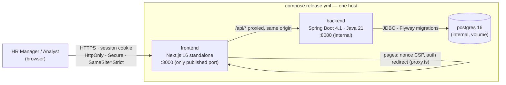
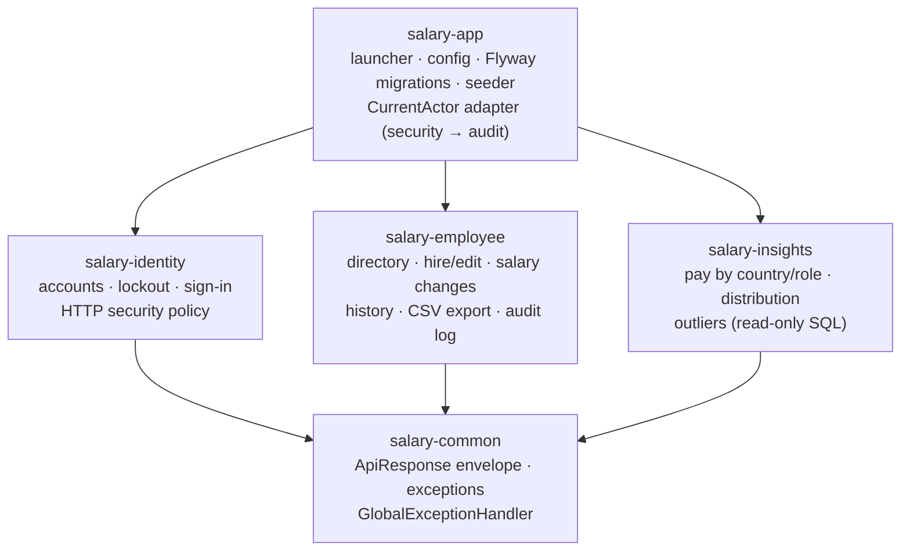
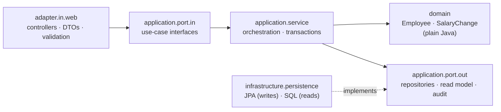
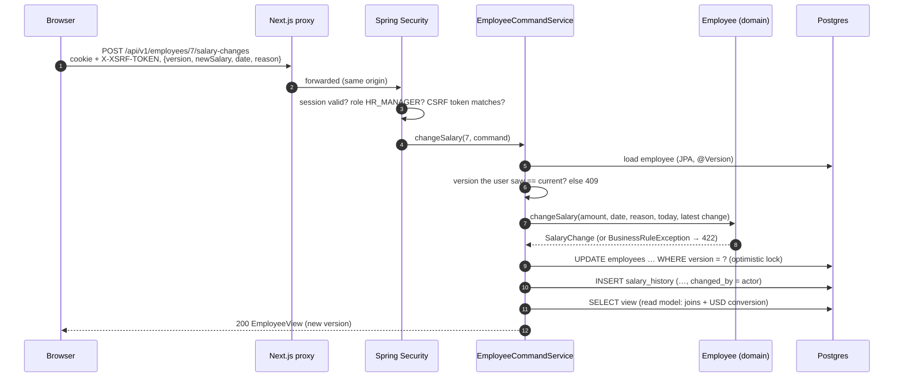
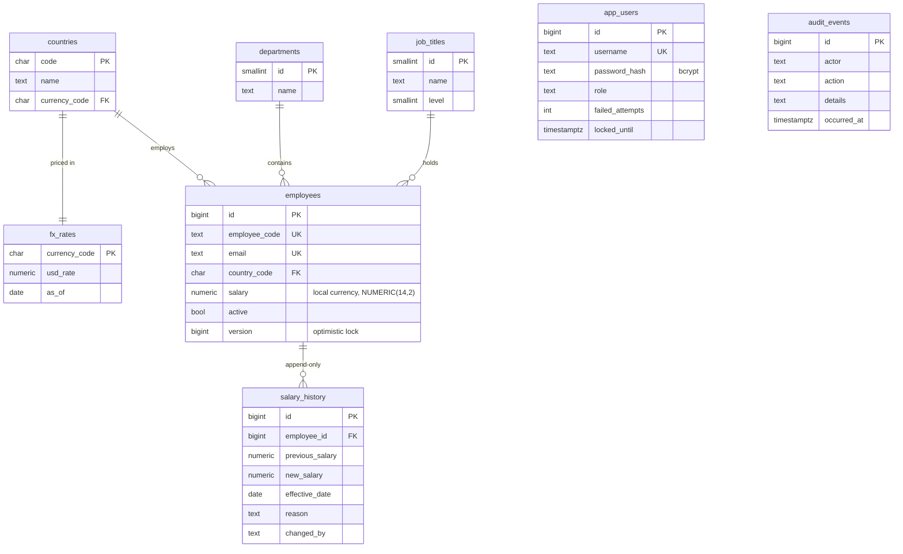
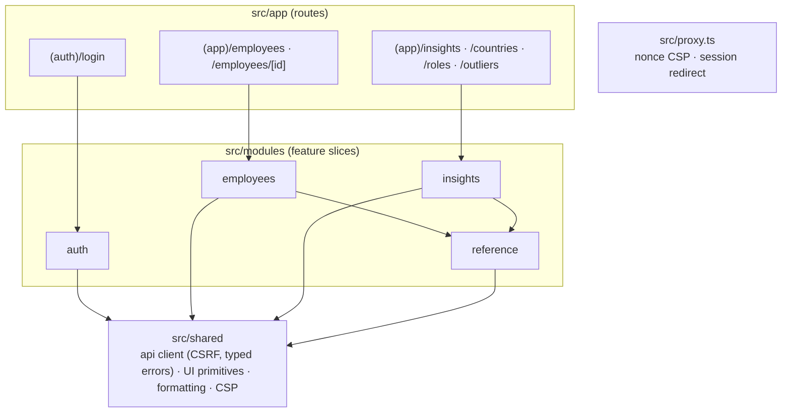
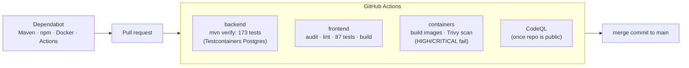

# Architecture

How the system fits together, from the browser down to the database. The *why* behind each
choice lives in the [ADRs](adr/); this page is the map.

## 1. Runtime view

- The browser only ever talks to **one origin**. Next.js serves the pages and forwards `/api/*`
  to Spring Boot, so cookies stay first-party and the API needs no CORS policy at all
  ([ADR-0006](adr/0006-session-authentication.md)).
- Only the UI port is published. The API and database are reachable solely inside the compose
  network; every container runs as a non-root user on a read-only filesystem with all Linux
  capabilities dropped.

## 2. Backend modules

A Maven modular monolith, structured like Craveo but sized for this problem
([ADR-0001](adr/0001-modular-monolith-hexagonal.md), [ADR-0004](adr/0004-what-we-left-out-from-craveo.md)).

Arrows are the only allowed dependencies; business modules never depend on each other (see the
rules below).

Inside each business module, ports and adapters keep the rules framework-free:

| Rule | Enforced by |
|---|---|
| `domain` imports no Spring, JPA or Hibernate | `ArchitectureTest` |
| `application` never sees adapters or infrastructure | `ArchitectureTest` |
| Controllers never reach persistence | `ArchitectureTest` |
| Business modules never import Spring Security; they ask `CurrentActor` | `ArchitectureTest` |
| `employee` and `insights` never import each other | `ArchitectureTest` |

## 3. Writes and reads take different paths

[ADR-0005](adr/0005-separate-read-and-write-paths.md): writes go through the domain model and JPA,
reads are one hand-written SQL query per screen.

## 4. Data model

- Salaries are stored **in local currency**, exactly; USD is computed at query time from a
  reference rate table ([ADR-0003](adr/0003-currency-handling.md)).
- Country and hire date are fixed after hiring (changing country would silently change the
  salary's currency); salary changes only through `salary_history`.

## 5. Frontend

Each module follows Craveo's admin-app layout: `api/` (HTTP calls) → `hooks/` (TanStack Query)
→ `components/`, with `types/` and `lib/` (pure, unit-tested logic such as URL state, form
schemas and chart geometry).

## 6. Delivery pipeline

